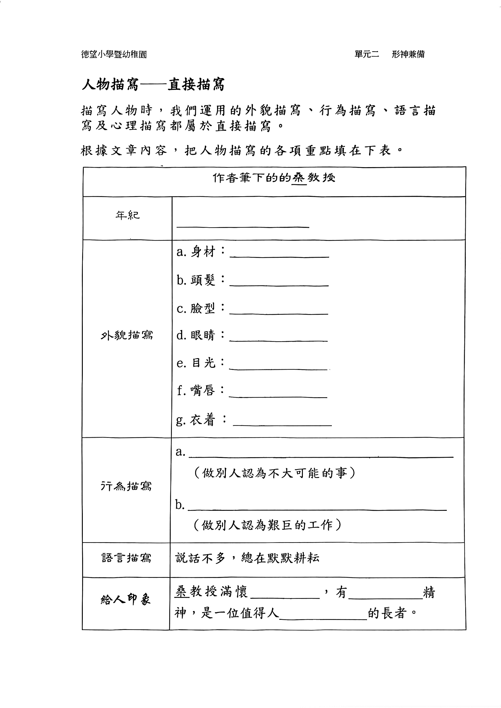
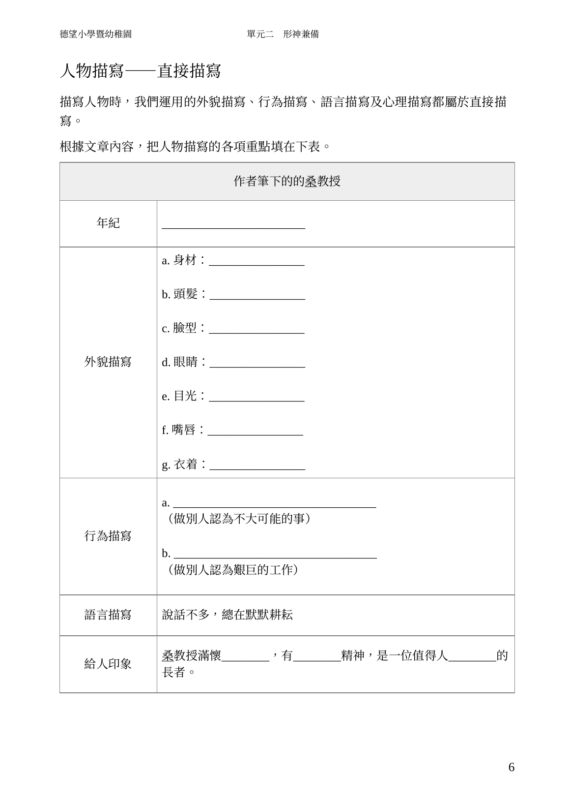
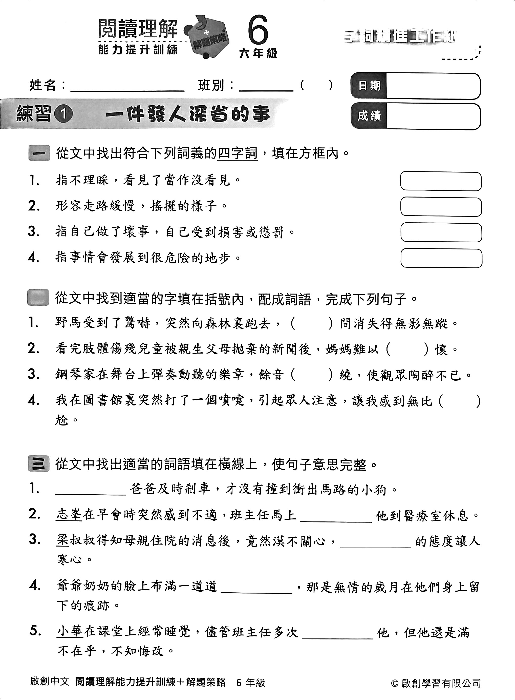
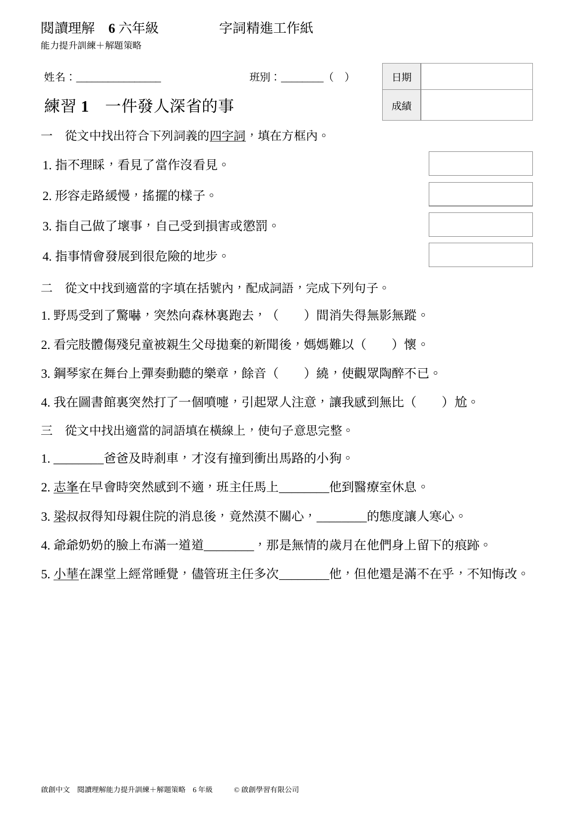

# 扫描 PDF 转可编辑 Word

[](https://github.com/laughing-glitch/scan-pdf-to-word-skill/actions/workflows/checks.yml)
[](https://github.com/laughing-glitch/scan-pdf-to-word-skill/releases/latest)
[](LICENSE)

给 WorkBuddy、Codex、Claude Code 使用的 Skill：把扫描教材、练习册、表单转成可编辑 Word，重点处理 OCR 错漏字、表格、题号和答题留白。

**安装后，把 PDF 发给 AI，说“转成可编辑 Word，逐页校对”，让 AI 按已经验证过的方法执行。**

这套方法来自两份繁体中文扫描资料的完整转换，每份 20 页。核心是逐页核对与原生 Word 重建；OCR 只是草稿来源。Skill 提供指引和工具，实际效果仍受原件清晰度、宿主模型及工具能力影响。

## 安装：选你正在用的工具

### WorkBuddy（Windows / Mac）

1. 在 [Releases 下载 `scan-pdf-to-word.zip`](https://github.com/laughing-glitch/scan-pdf-to-word-skill/releases/latest/download/scan-pdf-to-word.zip)。
2. 打开 **专家·技能·连接器 → 技能 → 添加技能 → 上传技能**，导入这个 ZIP。
3. 新开对话，上传 PDF，发送下面的使用提示。

这是纯技能包；不要把整份项目源码 ZIP 当作技能上传。WorkBuddy 的入口可能随版本调整，见[官方技能说明](https://www.workbuddy.cn/docs/workbuddy/From-Beginner-to-Expert-Guide/Function-Description/Skills-Market)。

### Codex（Windows / Mac）

把这句话发给 Codex：

> 请从 https://github.com/laughing-glitch/scan-pdf-to-word-skill 安装 skills/scan-pdf-to-word 这个技能，读完 SKILL.md 后检查运行环境。优先复用已有工具，缺少的 Python 库装进独立环境。

也可以下载 [starter 安装包](https://github.com/laughing-glitch/scan-pdf-to-word-skill/releases/latest/download/scan-pdf-to-word-starter.zip)，解压后运行安装器。安装器使用 Codex 当前文档中的用户技能目录 `~/.agents/skills`；通过 Codex 自带 skill-installer 安装时，使用该工具返回的实际目录即可。

### Claude Code（Windows / Mac）

下载 [starter 安装包](https://github.com/laughing-glitch/scan-pdf-to-word-skill/releases/latest/download/scan-pdf-to-word-starter.zip)，**先解压**：

- Windows：双击 `install-windows.cmd`，选择 Claude Code。
- Mac：运行 `install-mac.command`；若系统不允许直接打开，把整个解压目录交给 Claude Code，让它运行 `sh install.sh claude`。
- 熟悉终端时，也可直接运行 `sh install.sh claude`，或 PowerShell 的 `./install.ps1 -Target claude`。

安装器只复制技能文件，不覆盖已有同名技能、不修改系统设置。Claude Code 使用 `~/.claude/skills/scan-pdf-to-word`。安装后新开对话，使用 `/scan-pdf-to-word` 或自然语言提出转换要求。

## 开始使用

通用提示（附上你的 PDF）：

> 使用 scan-pdf-to-word，把这份扫描 PDF 全部转成可编辑 Word。逐页对照原图校对，保留原来的繁简体、题号、表格和空白答题栏。原稿疑似笔误请保留并加批注。完成后检查每页排版，把 Word 文件给我。

首次使用，AI 会检查 Python、OCR 和渲染工具，优先复用宿主已有组件。缺少 Python 库时由附带脚本创建独立环境；需要额外系统软件时，由 AI 说明组件和安装方法。**不需要另买 OCR API 或填写模型密钥，但宿主需要具备读图、执行脚本和写文件的能力。**

## 实际案例

下面左边是原扫描页，右边是转换后的 Word 渲染预览。版式为便于编辑而重建，字体和装饰不作像素级复刻。截图展示排版效果；可编辑性由原生内容检查和修改保存回读另行验证。

### 案例一：繁体学习资料中的合并表格

| 原扫描页 | 可编辑 Word 的渲染预览 |
| --- | --- |
|  |  |

全件 20 页，重建 10 个原生表格；保留了 15 处插图或手写局部图片。截图取第 7 源页，表格及文字可编辑，原稿重复的“的”保留并批注。

### 案例二：繁体阅读练习中的题目和填写栏

| 原扫描页 | 可编辑 Word 的渲染预览 |
| --- | --- |
|  |  |

全件 20 页，35 个原生表格，正文没有用整页图片替代。保留姓名、班别、日期、成绩栏、选项和空白；7 处原件疑似问题加批注，另有 1 条恢复褪色页眉/序号的说明。

以上为 **2026-10-28 的原流程案例**，不是声称新发布的通用脚本无需调整就能自动复刻所有复杂版面。发布版工具另有原创新样例及自动化回归，见[验证范围](docs/validation.md)。不发布这两份教材的完整 PDF / DOCX。

## 工作流

```text
扫描 PDF → 源页图像 → OCR 草稿 → AI 逐页看图校对
        → Word 原生段落/表格/批注 → 渲染每页复查 → 交付 DOCX
```

- Mac 可用 Apple Vision；Windows / Mac 都可用 Tesseract。OCR 不可用时，能看图的宿主仍可逐页转录。
- PDF 拆页使用 PDFium，Word 使用 python-docx，预览使用宿主工具或 LibreOffice。
- 技能不会擅自改原稿、补答案或把繁体转简体。原稿笔误与 OCR 识别错误分别处理。
- 本地辅助脚本不上传文档；把页面交给宿主 AI 阅读时，仍适用该宿主的数据规则。
- 不保证零错字，不承诺所有扫描件一键完成。复杂版面需要 AI 根据原件调整重建和复查。

## 兼容范围

| 项目 | 设计支持 | 验证方式 |
| --- | --- | --- |
| Windows / Mac 核心 Python 工具 | 支持 | 三系统 GitHub Actions 检查，状态见页首 |
| Codex 技能目录安装 | 支持 | 安装脚本与文件完整性检查 |
| Claude Code 技能目录安装 | 支持 | 安装脚本与文件完整性检查 |
| WorkBuddy ZIP 导入 | 按官方导入方式打包 | ZIP 结构检查；客户端导入尚需实际环境验证 |
| AI 逐页校对和完整 20 页交付 | 已有 Mac / Codex 案例 | 两份原流程案例；不外推为其他宿主模型准确率 |

换到其他系统或客户端，能安装技能并不等于该客户端整条流程已实测。发现兼容问题可提交 Issue，附系统、客户端版本、出错步骤；示例文件请使用可分享的最小样本。

## 开发与复现

```sh
python -m pip install -r skills/scan-pdf-to-word/requirements.txt
python -m unittest discover -s tests -v
python skills/scan-pdf-to-word/scripts/build_docx.py examples/demo-transcript.json --out work/demo.docx
python skills/scan-pdf-to-word/scripts/check_docx.py work/demo.docx --transcript examples/demo-transcript.json
python package_release.py
```

原创新样例是功能自测，不是 OCR 质量基准。更多命令在 [workflow.md](skills/scan-pdf-to-word/references/workflow.md)，环境说明在 [setup.md](skills/scan-pdf-to-word/references/setup.md)。

## 许可与参考

代码、Skill 指令和原创新样例使用 [MIT 许可](LICENSE)。案例书页及其文字内容归原权利人；此处仅作转换效果展示，不在 MIT 授权范围内。

安装路径依据：[Codex 官方文档](https://learn.chatgpt.com/docs/build-skills)、[Claude Code 官方文档](https://code.claude.com/docs/en/skills)、[WorkBuddy 官方文档](https://www.workbuddy.cn/docs/workbuddy/From-Beginner-to-Expert-Guide/Function-Description/Skills-Market)。
